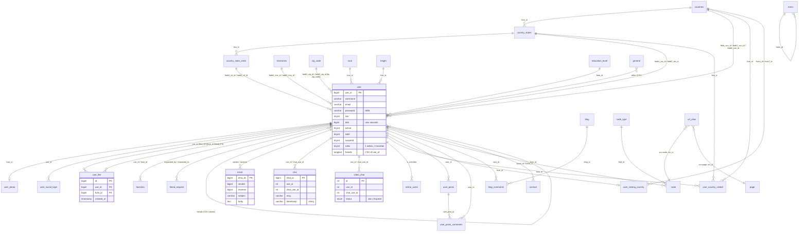

# WorldTaker legacy database — analysis

> Source of truth: `WorldTakeCare_Existing_PHPsource/Database/worldtaker.sql` (phpMyAdmin 5.2.3 dump,
> generated 12 Nov 2026 05:45, MariaDB 10.11.19, PHP 8.4.27).
> Analysed **read-only from the dump file**. No database connection was made and nothing was modified.
> No passwords, credentials or personal data are reproduced in this document — only structure and
> aggregate counts.

## 1. Overview

| Item | Value |
|---|---|
| Platform | MariaDB 10.11 (MySQL-compatible) on cPanel/CloudLinux shared hosting (`-cll-lve`) |
| Database | `worldtaker` |
| Tables | **41** |
| Views / stored procedures / functions / triggers / events | **None** |
| Storage engines | 21 InnoDB, 20 MyISAM (MyISAM has no transactions and no foreign keys) |
| Character sets | 33 `utf8mb3` (3-byte, no emoji), 8 `latin1` (`chat`, `chat_new`, `peer_chat`, `peer_userstatus`, `smilies`, `user_like`, `user_social_login`, `video_chat`) |
| Primary keys | 35 tables. **Missing on 6:** `friend_request`, `online_users1`, `password_request`, `user_country_visited`, `user_photo` (unique key only), `worldclock` |
| Foreign keys | **1** — `user_like.use_id` and `user_like.fuse_id` → `user.use_id` `ON DELETE CASCADE` |
| Unique keys | `user_like (use_id, fuse_id)`, `user_photo (fuse_id)`, `online_users1 (session)`, `online_users_hold (session)` |
| Secondary indexes | `country_states.fcon_id`, `country_state_cities.fsta_id`, `email (sender, receiver)`, `node.fpuse_id/fcuse_id/fndt_id`, `peer_chat.from/to`, `user (frac_id, fhei_id, fedu_id)`, `user_country_visited.fcon_id/fuse_id/fsta_id`, `user_like.fuse_id`, `user_visiting_country.fcon1_id/fuse_id/fcon2_id`, `zip_code.zip_code` |
| Not indexed although queried constantly | `user.email`, `user.username`, `user.provider_id`, `favorites.use_id/fuse_id`, `friend_request.*`, `chat.use_id/chat_use_id`, `online_users.is_member/session`, `video_chat.use_id/chat_use_id`, `user_social_login.profile_id` |
| Size | ~7 MB dump; ~84,800 lines; 90% of rows are reference data (`zip_code` 42,624, `country_state_cities` 35,446) |

Naming convention (important for migration): primary keys are `<3-letter prefix>_id`
(`use_id`, `con_id`, `sta_id`, …). A column named **`f<prefix>_id` is an implicit foreign key** to
the table owning `<prefix>_id` (e.g. `fuse_id` → `user.use_id`, `fcon_id` → `countries.con_id`).
Exceptions: `chat.chat_use_id`, `email.sender/receiver`, `friend_request.requested_by/to`,
`video_chat.use_id/chat_use_id`, `user_posts.user_id`, `blog_comments.user_id` (varchar!), and
`user.reli_id` (refers to a hard-coded list, no table).

### 1.1 Other SQL dumps found (historical, not authoritative)

| File | Date / server | Tables | Relationship to current schema |
|---|---|---|---|
| `Existing_Code/well-known/db-backup-1623483974-….sql` | Jun 2021 | 39 | Current schema minus `user_like` and `video_chat` (both added 2025) |
| `Existing_Code/well-known/php/db-backup-1633582832-….sql` | Oct 2021 | 39 | Same as above |
| `…/users/db_backup/_db_backups/myworldtaker.sql` | MySQL 5.0 (old host) | 23 | Early version of the current naming (`user`, `user_photo`, …) |
| `…/users/db_backup/_db_backups/newwtdb.sql` | MySQL 5.5 | 22 | Abandoned redesign: `users`, `users_tmp`, `users_upload`, `users_activation`, `updates`, and `block` (a **CMS content-block** table, *not* user blocking). Not used by current code |
| `…/users/db_backup/_db_backups/mylivetaker.sql` | MySQL 5.0 | 0 | Empty dump of a sister site |

> ⚠️ Three of these dumps sit **inside the public web root** with real member data and
> password hashes — they are downloadable by anyone who guesses the URL. Recommend removal from the
> production server (owner action; not done by us — the legacy project is read-only).

## 2. Table inventory

| # | Table | Engine | Charset | Rows | PK | Purpose | Status in code |
|---|---|---|---|---:|---|---|---|
| 1 | `user` | InnoDB | utf8mb3 | 250 | `use_id` AI | Member account **and** full profile (52 columns) | Core |
| 2 | `user_tmp` | InnoDB | utf8mb3 | 31 | `use_id` AI | Pending registrations awaiting email activation | Active |
| 3 | `user_activation` | MyISAM | utf8mb3 | 0 | `fuse_id` | Old activation-token table | **Unused** (empty; tokens now in `user_tmp.qr`) |
| 4 | `password_request` | MyISAM | utf8mb3 | 11 | — | Old password-reset tokens (2012) | **Unused** (now `user.pass_tmp`) |
| 5 | `user_social_login` | MyISAM | latin1 | 102 | `sid` AI | Social provider profile snapshot (Facebook, Google, Twitter, Microsoft, Apple) | Active |
| 6 | `user_photo` | InnoDB | utf8mb3 | 85 | — (UNIQUE `fuse_id`) | 14 fixed photo slots per member | Active |
| 7 | `user_like` | InnoDB | latin1 | 7 | `id` AI | Member likes another member | Active (2025+) |
| 8 | `favorites` | MyISAM | utf8mb3 | 36 | `fav_id` AI | Member bookmarks another member | Active |
| 9 | `friend_request` | MyISAM | utf8mb3 | 60 | — | Pending friend requests | Active |
| 10 | `email` | InnoDB | utf8mb3 | 459 | `ema_id` AI | Private messages (inbox) — *not* emails | Active |
| 11 | `chat` | InnoDB | latin1 | 605 | `chat_id` AI | Live chat lines + legacy webcam invites | Active |
| 12 | `chat_new` | InnoDB | latin1 | 3 | `chat_id` AI | Copy of `chat` from a 2015 experiment | **Unused** |
| 13 | `smilies` | InnoDB | latin1 | 22 | `id` AI | Emoticon codes for chat | Active |
| 14 | `video_chat` | InnoDB | latin1 | 8 | `id` AI | VideoSDK one-to-one call sessions | Active (2025+) |
| 15 | `peer_chat` | InnoDB | latin1 | 3 | `id` AI | 2014 WebRTC/Flash chat prototype | **Unused** |
| 16 | `peer_userstatus` | MyISAM | latin1 | 2 | `username` | 2014 prototype presence | **Unused** |
| 17 | `online_users` | MyISAM | utf8mb3 | 121 | `oid` AI | Visitor/member activity in the last 5 min | Active (written on every request) |
| 18 | `online_users1` | InnoDB | utf8mb3 | 4 | — (UNIQUE `session`) | Old presence table | **Unused** |
| 19 | `online_users_hold` | InnoDB | utf8mb3 | 1 | `oid` AI | Old presence table | **Unused** |
| 20 | `user_country_visited` | MyISAM | utf8mb3 | 242 | — | Countries/states a member has visited | Active |
| 21 | `user_visiting_country` | MyISAM | utf8mb3 | 25 | `vc_id` AI | Up to 2 countries a member plans to visit | Active |
| 22 | `user_posts` | MyISAM | utf8mb3 | 6 | `web_id` AI | Member status posts with image | Active |
| 23 | `user_posts_comments` | MyISAM | utf8mb3 | 29 | `web_id` AI | Comments on member posts | Active |
| 24 | `blog` | MyISAM | utf8mb3 | 1 | `web_id` AI | Admin blog posts | Active (low use) |
| 25 | `blog_comments` | MyISAM | utf8mb3 | 8 | `web_id` AI | Member comments on blog posts | Active (low use) |
| 26 | `contact` | MyISAM | utf8mb3 | 23 | `con_id` AI | Contact-form submissions (2017, mostly spam) | **No longer written** (form only emails) |
| 27 | `node` | InnoDB | utf8mb3 | 7 | `nod_id` AI | CMS content (About, Terms, Privacy, …) | Active |
| 28 | `node_type` | MyISAM | utf8mb3 | 2 | `ndt_id` AI | CMS content types (Page, Story) | Active |
| 29 | `page` | MyISAM | utf8mb3 | 3 | `pag_id` AI | CMS "pages" (search, contact-me) | Active |
| 30 | `menu` | MyISAM | utf8mb3 | 5 | `men_id` AI | Site menus (footer) | Active |
| 31 | `url_alias` | InnoDB | utf8mb3 | 25 | `ura_id` AI | Friendly URL → node/page | Active (front controller) |
| 32 | `worldclock` | MyISAM | utf8mb3 | 1 | — | Embedded world-clock iframe HTML | Active (admin-editable) |
| 33 | `countries` | InnoDB | utf8mb3 | 241 | `con_id` AI | Countries (ISO-2 code, dial code) | Reference |
| 34 | `country_states` | InnoDB | utf8mb3 | 3,226 | `sta_id` AI | States/provinces | Reference |
| 35 | `country_state_cities` | InnoDB | utf8mb3 | 35,446 | `cit_id` AI | Cities (mostly USA) | Reference |
| 36 | `zip_code` | MyISAM | utf8mb3 | 42,624 | `id` AI | US zip codes with lat/lon | Reference |
| 37 | `timezones` | InnoDB | utf8mb3 | 32 | `tmz_id` AI | Fixed-offset time zones | Reference |
| 38 | `race` | InnoDB | utf8mb3 | 9 | `rac_id` AI | Ethnicity list | Reference |
| 39 | `height` | InnoDB | utf8mb3 | 13 | `hei_id` AI | Height list | Reference |
| 40 | `education_level` | InnoDB | utf8mb3 | 8 | `edu_id` AI | Education list | Reference |
| 41 | `general` | MyISAM | utf8mb3 | 4 | `gen_id` AI | Lifestyle tags (Non Smoker, Vegetarian, Tourist Guide, Have Children) | Reference |

AI = `AUTO_INCREMENT`. Current next values: `user` 847, `user_tmp` 97, `chat` 664, `email` 467,
`favorites` 144, `user_like` 53, `video_chat` 212, `user_social_login` 233, `online_users` 439,893.

**Tables that do not exist** although a dating app would typically have them (confirmed by searching
code and every dump): blocks, reports/abuse, notifications, matches, subscriptions/payments/plans,
user preferences/partner criteria, verification, audit log, sessions/tokens.

## 3. Table-by-table columns

Generated directly from the `CREATE TABLE` and `ALTER TABLE … ADD KEY` statements of the dump.
"Implicit FK" = relationship inferred from naming + PHP queries; it is **not** enforced by the database.

### `blog`

MyISAM · utf8mb3 · 5 columns · AUTO_INCREMENT on `web_id` (next 59)

Keys: PK (web_id)

| Column | Type | Null | Default | Key | Notes / implicit relation |
|---|---|---|---|---|---|
| `web_id` | int(11) | no |  | PK |  |
| `web_title` | varchar(100) | no |  |  |  |
| `web_content` | varchar(5000) | no |  |  |  |
| `time` | varchar(100) | no |  |  |  |
| `img` | varchar(100) | no |  |  |  |

### `blog_comments`

MyISAM · utf8mb3 · 5 columns · AUTO_INCREMENT on `web_id` (next 50)

Keys: PK (web_id)

| Column | Type | Null | Default | Key | Notes / implicit relation |
|---|---|---|---|---|---|
| `web_id` | int(11) | no |  | PK |  |
| `comments` | varchar(2000) | no |  |  |  |
| `blog_id` | varchar(100) | no |  |  | → blog.web_id (varchar) |
| `time` | varchar(100) | no |  |  |  |
| `user_id` | varchar(100) | no |  |  | → user.use_id (varchar) |

### `chat`

InnoDB · latin1 · 9 columns · AUTO_INCREMENT on `chat_id` (next 664)

Keys: PK (chat_id)

| Column | Type | Null | Default | Key | Notes / implicit relation |
|---|---|---|---|---|---|
| `chat_id` | bigint(50) | no |  | PK |  |
| `use_id` | int(100) | no |  |  | → user.use_id (sender; 0 = system webcam row) |
| `chat_use_id` | int(100) | no |  |  | → user.use_id (receiver) |
| `msg` | varchar(250) | no |  |  |  |
| `timestamp` | varchar(250) | no |  |  | string, 3 formats |
| `stratus` | text | yes | NULL |  | Adobe Stratus peer key (webcam rows) |
| `action` | bigint(100) | yes | NULL |  | 0 text, 1 webcam invite, 2 accepted, -1 missed |
| `online` | varchar(50) | no |  |  |  |
| `displayed` | varchar(1) | no |  |  | '0' unread / '1' shown |

### `chat_new`

InnoDB · latin1 · 9 columns · AUTO_INCREMENT on `chat_id` (next 4)

Keys: PK (chat_id)

| Column | Type | Null | Default | Key | Notes / implicit relation |
|---|---|---|---|---|---|
| `chat_id` | bigint(50) | no |  | PK |  |
| `use_id` | int(100) | no |  |  | → user.use_id |
| `chat_use_id` | int(100) | no |  |  | → user.use_id |
| `msg` | varchar(250) | no |  |  |  |
| `timestamp` | varchar(250) | no |  |  |  |
| `stratus` | text | yes | NULL |  |  |
| `action` | bigint(100) | no |  |  |  |
| `online` | varchar(50) | no |  |  |  |
| `displayed` | varchar(1) | no |  |  |  |

### `contact`

MyISAM · utf8mb3 · 9 columns · AUTO_INCREMENT on `con_id` (next 287)

Keys: PK (con_id)

| Column | Type | Null | Default | Key | Notes / implicit relation |
|---|---|---|---|---|---|
| `con_id` | bigint(20) | no |  | PK |  |
| `email` | varchar(100) | no |  |  |  |
| `subject` | varchar(255) | no |  |  |  |
| `message` | text | no |  |  |  |
| `submitted` | bigint(20) | no |  |  | unix s |
| `ip` | varchar(50) | no |  |  |  |
| `fuse_id` | bigint(20) | no |  |  | → user.use_id (0 = guest) |
| `read_status` | int(10) | no |  |  |  |
| `new_msg` | int(11) | no |  |  |  |

### `countries`

InnoDB · utf8mb3 · 8 columns · AUTO_INCREMENT on `con_id` (next 262)

Keys: PK (con_id)

| Column | Type | Null | Default | Key | Notes / implicit relation |
|---|---|---|---|---|---|
| `con_id` | int(10) UNSIGNED | no |  | PK |  |
| `code` | varchar(2) | yes | NULL |  |  |
| `name` | varchar(100) | yes | NULL |  |  |
| `call_code` | int(3) | yes | NULL |  |  |
| `body` | text | no |  |  |  |
| `flag` | varchar(12) | no |  |  |  |
| `continent` | tinyint(1) | no |  |  |  |
| `display_order` | int(5) | no |  |  |  |

### `country_states`

InnoDB · utf8mb3 · 4 columns · AUTO_INCREMENT on `sta_id` (next 4352)

Keys: PK (sta_id); IDX `fcon_id` (fcon_id)

| Column | Type | Null | Default | Key | Notes / implicit relation |
|---|---|---|---|---|---|
| `sta_id` | int(11) | no |  | PK |  |
| `name` | varchar(50) | no |  |  |  |
| `body` | text | no |  |  |  |
| `fcon_id` | int(11) | no |  | IDX | → countries.con_id |

### `country_state_cities`

InnoDB · utf8mb3 · 4 columns · AUTO_INCREMENT on `cit_id` (next 35457)

Keys: PK (cit_id); IDX `fsta_id` (fsta_id)

| Column | Type | Null | Default | Key | Notes / implicit relation |
|---|---|---|---|---|---|
| `cit_id` | int(11) | no |  | PK |  |
| `name` | varchar(50) | no |  |  |  |
| `body` | text | no |  |  |  |
| `fsta_id` | int(11) | no |  | IDX | → country_states.sta_id |

### `education_level`

InnoDB · utf8mb3 · 5 columns · AUTO_INCREMENT on `edu_id` (next 17)

Keys: PK (edu_id)

| Column | Type | Null | Default | Key | Notes / implicit relation |
|---|---|---|---|---|---|
| `edu_id` | bigint(20) | no |  | PK |  |
| `name` | varchar(50) | no |  |  |  |
| `body` | text | no |  |  |  |
| `priority` | bigint(20) | no |  |  |  |
| `lang` | varchar(4) | no | 'en' |  |  |

### `email`

InnoDB · utf8mb3 · 10 columns · AUTO_INCREMENT on `ema_id` (next 467)

Keys: PK (ema_id); IDX `sender` (sender, receiver)

| Column | Type | Null | Default | Key | Notes / implicit relation |
|---|---|---|---|---|---|
| `ema_id` | bigint(20) | no |  | PK |  |
| `send_date` | varchar(50) | no |  |  | unix s as string |
| `subject` | varchar(200) | no |  |  |  |
| `body` | text | no |  |  |  |
| `sender` | bigint(20) | no |  | IDX | → user.use_id |
| `receiver` | bigint(20) | no |  | IDX | → user.use_id |
| `readby_sender` | tinyint(1) | no | 0 |  |  |
| `readby_receiver` | tinyint(1) | no | 0 |  |  |
| `deleteby_sender` | tinyint(1) | no | 0 |  |  |
| `deleteby_receiver` | tinyint(1) | no | 0 |  |  |

### `favorites`

MyISAM · utf8mb3 · 3 columns · AUTO_INCREMENT on `fav_id` (next 144)

Keys: PK (fav_id)

| Column | Type | Null | Default | Key | Notes / implicit relation |
|---|---|---|---|---|---|
| `fav_id` | bigint(50) | no |  | PK |  |
| `use_id` | bigint(50) | no |  |  | → user.use_id (owner) |
| `fuse_id` | bigint(50) | no |  |  | → user.use_id (favorited) |

### `friend_request`

MyISAM · utf8mb3 · 3 columns

Keys: **none**

| Column | Type | Null | Default | Key | Notes / implicit relation |
|---|---|---|---|---|---|
| `requested_date` | varbinary(50) | no |  |  | unix s stored as varbinary |
| `requested_by` | bigint(20) | no |  |  | → user.use_id |
| `requested_to` | bigint(20) | no |  |  | → user.use_id |

### `general`

MyISAM · utf8mb3 · 4 columns · AUTO_INCREMENT on `gen_id` (next 14)

Keys: PK (gen_id)

| Column | Type | Null | Default | Key | Notes / implicit relation |
|---|---|---|---|---|---|
| `gen_id` | int(4) | no |  | PK |  |
| `name` | varchar(200) | no |  |  |  |
| `body` | tinytext | no |  |  |  |
| `priority` | int(4) | no | 99 |  |  |

### `height`

InnoDB · utf8mb3 · 4 columns · AUTO_INCREMENT on `hei_id` (next 36)

Keys: PK (hei_id)

| Column | Type | Null | Default | Key | Notes / implicit relation |
|---|---|---|---|---|---|
| `hei_id` | tinyint(3) | no |  | PK |  |
| `name` | varchar(20) | no |  |  |  |
| `body` | text | no |  |  |  |
| `priority` | tinyint(3) | no |  |  |  |

### `menu`

MyISAM · utf8mb3 · 7 columns · AUTO_INCREMENT on `men_id` (next 25)

Keys: PK (men_id)

| Column | Type | Null | Default | Key | Notes / implicit relation |
|---|---|---|---|---|---|
| `men_id` | int(11) | no |  | PK |  |
| `title` | varchar(222) | no |  |  |  |
| `url` | varchar(222) | no |  |  |  |
| `body` | text | no |  |  |  |
| `published` | tinyint(1) | no | 1 |  |  |
| `priority` | int(11) | no | 99999 |  |  |
| `fmen_id` | tinyint(1) | no | 0 |  | → menu.men_id (parent) |

### `node`

InnoDB · utf8mb3 · 12 columns · AUTO_INCREMENT on `nod_id` (next 29)

Keys: PK (nod_id); IDX `fpuse_id` (fpuse_id); IDX `fcuse_id` (fcuse_id); IDX `fndt_id` (fndt_id)

| Column | Type | Null | Default | Key | Notes / implicit relation |
|---|---|---|---|---|---|
| `nod_id` | bigint(20) | no |  | PK |  |
| `title` | text | yes | NULL |  |  |
| `img` | varchar(200) | yes | NULL |  |  |
| `body` | longtext | yes | NULL |  |  |
| `published` | tinyint(1) | yes | 1 |  |  |
| `view_count` | bigint(20) | yes | 1 |  |  |
| `isdel` | tinyint(1) | no | 1 |  | default 1 on every row; not read by any query |
| `posted` | bigint(20) | yes | NULL |  |  |
| `changed` | bigint(20) | yes | NULL |  |  |
| `fpuse_id` | bigint(20) | no | 3 | IDX | → user.use_id (author) |
| `fcuse_id` | bigint(20) | no | 0 | IDX | → user.use_id (last editor) |
| `fndt_id` | int(11) | no |  | IDX | → node_type.ndt_id |

### `node_type`

MyISAM · utf8mb3 · 4 columns · AUTO_INCREMENT on `ndt_id` (next 10)

Keys: PK (ndt_id)

| Column | Type | Null | Default | Key | Notes / implicit relation |
|---|---|---|---|---|---|
| `ndt_id` | int(11) | no |  | PK |  |
| `name` | tinytext | no |  |  |  |
| `machine_name` | varchar(200) | no |  |  |  |
| `body` | text | no |  |  |  |

### `online_users`

MyISAM · utf8mb3 · 4 columns · AUTO_INCREMENT on `oid` (next 439893)

Keys: PK (oid)

| Column | Type | Null | Default | Key | Notes / implicit relation |
|---|---|---|---|---|---|
| `oid` | int(10) | no |  | PK |  |
| `session` | int(75) | no |  |  | ip2long(client IP) — overflows to 2147483647 |
| `time` | int(50) | no |  |  | unix s |
| `is_member` | int(10) | no |  |  | → user.use_id (0 = guest) |

### `online_users1`

InnoDB · utf8mb3 · 3 columns

Keys: UQ `session` (session)

| Column | Type | Null | Default | Key | Notes / implicit relation |
|---|---|---|---|---|---|
| `session` | varchar(200) | no |  | UQ |  |
| `time` | varchar(200) | no |  |  |  |
| `is_member` | varchar(200) | no | '0' |  |  |

### `online_users_hold`

InnoDB · utf8mb3 · 4 columns · AUTO_INCREMENT on `oid` (next 2)

Keys: PK (oid); UQ `session` (session)

| Column | Type | Null | Default | Key | Notes / implicit relation |
|---|---|---|---|---|---|
| `oid` | int(10) | no |  | PK |  |
| `session` | int(20) | no |  | UQ |  |
| `time` | bigint(20) | no |  |  |  |
| `is_member` | tinyint(1) | no | 0 |  |  |

### `page`

MyISAM · utf8mb3 · 5 columns · AUTO_INCREMENT on `pag_id` (next 71)

Keys: PK (pag_id)

| Column | Type | Null | Default | Key | Notes / implicit relation |
|---|---|---|---|---|---|
| `pag_id` | int(11) | no |  | PK |  |
| `name` | tinytext | no |  |  |  |
| `machine_name` | tinytext | no |  |  |  |
| `body` | text | no |  |  |  |
| `published` | tinyint(1) | no | 1 |  |  |

### `password_request`

MyISAM · utf8mb3 · 3 columns

Keys: **none**

| Column | Type | Null | Default | Key | Notes / implicit relation |
|---|---|---|---|---|---|
| `use_id` | bigint(20) | no |  |  | → user.use_id |
| `qr` | varchar(100) | no |  |  |  |
| `expiry` | varchar(50) | no |  |  |  |

### `peer_chat`

InnoDB · latin1 · 10 columns · AUTO_INCREMENT on `id` (next 4)

Keys: PK (id); IDX `from` (from); IDX `to` (to)

| Column | Type | Null | Default | Key | Notes / implicit relation |
|---|---|---|---|---|---|
| `id` | int(10) UNSIGNED | no |  | PK |  |
| `from` | varchar(255) | no | '' | IDX |  |
| `to` | varchar(255) | no | '' | IDX |  |
| `message` | text | no |  |  |  |
| `sent` | datetime | no | '0000-00-00 00:00:00' |  |  |
| `recd` | int(10) UNSIGNED | no | 0 |  |  |
| `sex` | varchar(5) | no |  |  |  |
| `stratus` | text | no |  |  |  |
| `action` | int(11) | no | 0 |  |  |
| `online` | int(11) | no | 0 |  |  |

### `peer_userstatus`

MyISAM · latin1 · 2 columns

Keys: PK (username)

| Column | Type | Null | Default | Key | Notes / implicit relation |
|---|---|---|---|---|---|
| `username` | varchar(100) | no |  | PK |  |
| `date` | datetime | no |  |  |  |

### `race`

InnoDB · utf8mb3 · 5 columns · AUTO_INCREMENT on `rac_id` (next 35)

Keys: PK (rac_id)

| Column | Type | Null | Default | Key | Notes / implicit relation |
|---|---|---|---|---|---|
| `rac_id` | bigint(20) | no |  | PK |  |
| `name` | varchar(50) | no |  |  |  |
| `body` | text | no |  |  |  |
| `priority` | bigint(20) | no |  |  |  |
| `lang` | varchar(4) | no | 'en' |  |  |

### `smilies`

InnoDB · latin1 · 3 columns · AUTO_INCREMENT on `id` (next 24)

Keys: PK (id)

| Column | Type | Null | Default | Key | Notes / implicit relation |
|---|---|---|---|---|---|
| `id` | int(100) | no |  | PK |  |
| `image_code` | varchar(100) | no |  |  |  |
| `path` | varchar(100) | no |  |  |  |

### `timezones`

InnoDB · utf8mb3 · 4 columns · AUTO_INCREMENT on `tmz_id` (next 42)

Keys: PK (tmz_id)

| Column | Type | Null | Default | Key | Notes / implicit relation |
|---|---|---|---|---|---|
| `tmz_id` | tinyint(2) | no |  | PK |  |
| `name` | varchar(70) | no |  |  |  |
| `offset` | float | no |  |  |  |
| `priority` | int(11) | no | 9999 |  |  |

### `url_alias`

InnoDB · utf8mb3 · 5 columns · AUTO_INCREMENT on `ura_id` (next 47)

Keys: PK (ura_id)

| Column | Type | Null | Default | Key | Notes / implicit relation |
|---|---|---|---|---|---|
| `ura_id` | bigint(20) | no |  | PK |  |
| `src` | varchar(222) | no |  |  | 'node' \| 'page' |
| `src_id` | bigint(20) | no |  |  | → node.nod_id or page.pag_id (polymorphic) |
| `dst` | text | no |  |  |  |
| `dst_manual` | text | no |  |  |  |

### `user`

InnoDB · utf8mb3 · 52 columns · AUTO_INCREMENT on `use_id` (next 847)

Keys: PK (use_id); IDX `frac_id` (frac_id, fhei_id, fedu_id)

| Column | Type | Null | Default | Key | Notes / implicit relation |
|---|---|---|---|---|---|
| `use_id` | bigint(20) | no |  | PK |  |
| `username` | varchar(50) | yes | NULL |  |  |
| `password` | varchar(50) | no |  |  | unsalted MD5 hex |
| `pass_tmp` | varchar(222) | yes | NULL |  | password-reset code (MD5 of small random int) |
| `pass_date` | bigint(20) | yes | NULL |  | reset requested (unix s), never checked |
| `email` | varchar(50) | no |  |  |  |
| `fname` | varchar(30) | no |  |  |  |
| `lname` | varchar(30) | no |  |  |  |
| `friends` | longtext | yes | NULL |  | CSV of use_id — accepted friends |
| `sex` | tinyint(1) | no | 1 |  | 0 unset, 1 male, 2 female |
| `marital_status` | tinyint(1) | no | 1 |  | 1 Available … 8 Widowed, 9 Offline (hidden from search) |
| `dob` | bigint(20) | yes | NULL |  | unix seconds |
| `other` | varchar(222) | yes | NULL |  | CSV of general.gen_id |
| `looking_to_meet` | varchar(50) | yes | NULL |  |  |
| `write_something` | blob | yes | NULL |  | rich HTML |
| `about` | blob | yes | NULL |  | rich HTML |
| `languages` | text | yes | NULL |  |  |
| `img` | tinytext | yes | NULL |  | avatar file in users/{id}/avata/ |
| `bg_music` | varchar(200) | yes | NULL |  | MP3 file in users/{id}/ |
| `video` | text | yes | NULL |  | CSV of YouTube video ids |
| `online` | tinyint(1) | no | 0 |  | never written (always 0) |
| `active` | tinyint(1) | no | 1 |  | 1 activated |
| `isdel` | tinyint(1) | no | 0 |  | 1 soft-deleted by admin |
| `suspend` | tinyint(1) | no | 0 |  | 1 suspended by admin |
| `roles` | tinyint(1) | no | 3 |  | 1 admin, 3 member |
| `registered` | varchar(50) | yes | NULL |  | unix seconds as string |
| `activated_date` | bigint(20) | yes | NULL |  |  |
| `suspended_date` | bigint(20) | yes | NULL |  |  |
| `deleted_date` | bigint(20) | yes | NULL |  |  |
| `registered_ip` | varchar(50) | yes | NULL |  |  |
| `last_logged` | bigint(20) | yes | NULL |  | never written |
| `add1` | varchar(222) | yes | NULL |  |  |
| `fadd1_zip_id` | varchar(10) | yes | NULL |  | → zip_code.zip_code (USA) |
| `add2` | varchar(222) | yes | NULL |  |  |
| `fadd2_zip_id` | varchar(10) | yes | NULL |  | → zip_code.zip_code (USA) |
| `fadd1_con_id` | int(11) | yes | 0 |  | → countries |
| `fadd1_sta_id` | int(11) | yes | 0 |  | → country_states |
| `fadd1_cit_id` | varchar(500) | yes | NULL |  | → country_state_cities (varchar; sometimes free text) |
| `fadd1_tmz_id` | varchar(50) | yes | '0' |  | → timezones (varchar) |
| `fadd2_con_id` | int(11) | yes | 0 |  | → countries |
| `fadd2_sta_id` | int(11) | yes | 0 |  | → country_states |
| `fadd2_cit_id` | varchar(500) | yes | NULL |  | → country_state_cities (varchar; sometimes free text) |
| `fadd2_tmz_id` | varchar(50) | yes | '0' |  | → timezones (varchar) |
| `fdob_con_id` | int(11) | yes | NULL |  | → countries (country of birth) |
| `frac_id` | bigint(20) | yes | NULL | IDX | → race |
| `reli_id` | bigint(50) | yes | NULL |  | hard-coded 1 Buddhism, 2 Christianity, 3 Hinduism, 4 Islam, 5 Judaism, 6 No Religion, 7 Other |
| `other_religion` | varchar(200) | yes | NULL |  |  |
| `fhei_id` | tinyint(3) | yes | NULL | IDX | → height |
| `fedu_id` | bigint(20) | yes | NULL | IDX | → education_level |
| `provider_id` | varchar(200) | yes | NULL |  | social provider user id |
| `profile_img` | tinytext | yes | NULL |  | gallery file name |
| `fdob_nationality_id` | varchar(255) | yes | NULL |  | CSV of countries.con_id |

### `user_activation`

MyISAM · utf8mb3 · 3 columns

Keys: PK (fuse_id)

| Column | Type | Null | Default | Key | Notes / implicit relation |
|---|---|---|---|---|---|
| `fuse_id` | bigint(20) | no |  | PK | → user.use_id |
| `qr` | varchar(200) | no |  |  |  |
| `expiry` | varchar(50) | no |  |  |  |

### `user_country_visited`

MyISAM · utf8mb3 · 3 columns

Keys: IDX `fcon_id` (fcon_id); IDX `fuse_id` (fuse_id); IDX `fsta_id` (fsta_id)

| Column | Type | Null | Default | Key | Notes / implicit relation |
|---|---|---|---|---|---|
| `fuse_id` | bigint(20) | no |  | IDX | → user.use_id |
| `fcon_id` | int(11) | no |  | IDX | → countries.con_id |
| `fsta_id` | int(11) | no | 0 | IDX | → country_states.sta_id (0 = none) |

### `user_like`

InnoDB · latin1 · 4 columns · AUTO_INCREMENT on `id` (next 53)

Keys: PK (id); UQ `use_id` (use_id, fuse_id); IDX `fuse_id` (fuse_id) · `use_id` FK → user.use_id ON DELETE CASCADE; `fuse_id` FK → user.use_id ON DELETE CASCADE

| Column | Type | Null | Default | Key | Notes / implicit relation |
|---|---|---|---|---|---|
| `id` | bigint(20) | no |  | PK |  |
| `use_id` | bigint(20) | no |  | UQ | FK → user.use_id ON DELETE CASCADE |
| `fuse_id` | bigint(20) | no |  | UQ, IDX | FK → user.use_id ON DELETE CASCADE |
| `created_at` | timestamp | no | current_timestamp() |  |  |

### `user_photo`

InnoDB · utf8mb3 · 15 columns

Keys: UQ `use_id` (fuse_id)

| Column | Type | Null | Default | Key | Notes / implicit relation |
|---|---|---|---|---|---|
| `fuse_id` | int(11) | no |  | UQ | → user.use_id |
| `img1` | varchar(200) | yes | NULL |  |  |
| `img2` | varchar(200) | yes | NULL |  |  |
| `img3` | varchar(200) | yes | NULL |  |  |
| `img4` | varchar(200) | yes | NULL |  |  |
| `img5` | varchar(200) | yes | NULL |  |  |
| `img6` | varchar(200) | yes | NULL |  |  |
| `img7` | varchar(200) | yes | NULL |  |  |
| `img8` | varchar(200) | yes | NULL |  |  |
| `img9` | varchar(200) | yes | NULL |  |  |
| `img10` | varchar(200) | yes | NULL |  |  |
| `img11` | varchar(200) | yes | NULL |  |  |
| `img12` | varchar(200) | yes | NULL |  |  |
| `img13` | varchar(200) | yes | NULL |  |  |
| `img14` | varchar(200) | yes | NULL |  |  |

### `user_posts`

MyISAM · utf8mb3 · 6 columns · AUTO_INCREMENT on `web_id` (next 59)

Keys: PK (web_id)

| Column | Type | Null | Default | Key | Notes / implicit relation |
|---|---|---|---|---|---|
| `web_id` | int(11) | no |  | PK |  |
| `user_id` | int(11) | no |  |  | → user.use_id |
| `user_post` | varchar(500) | no |  |  |  |
| `user_picture` | varchar(500) | no | ' ' |  |  |
| `user_date` | varchar(100) | no |  |  | 'Month dd hh:mm:ss am' — no year |
| `user_title` | varchar(300) | no |  |  |  |

### `user_posts_comments`

MyISAM · utf8mb3 · 5 columns · AUTO_INCREMENT on `web_id` (next 36)

Keys: PK (web_id)

| Column | Type | Null | Default | Key | Notes / implicit relation |
|---|---|---|---|---|---|
| `web_id` | int(11) | no |  | PK |  |
| `user_id` | int(11) | no |  |  | → user.use_id |
| `user_post_id` | int(11) | no |  |  | → user_posts.web_id |
| `user_comments` | varchar(500) | no |  |  |  |
| `user_date` | varchar(50) | no |  |  | no year |

### `user_social_login`

MyISAM · latin1 · 11 columns · AUTO_INCREMENT on `sid` (next 233)

Keys: PK (sid)

| Column | Type | Null | Default | Key | Notes / implicit relation |
|---|---|---|---|---|---|
| `sid` | bigint(50) | no |  | PK |  |
| `provider` | varchar(200) | no |  |  |  |
| `profile_id` | varchar(100) | no |  |  | provider user id |
| `firstName` | varchar(200) | no |  |  |  |
| `lastName` | varchar(200) | no |  |  |  |
| `provideremail` | varchar(200) | yes | NULL |  |  |
| `gender` | varchar(100) | yes | NULL |  |  |
| `birthMonth` | varchar(100) | yes | NULL |  |  |
| `birthDay` | varchar(100) | yes | NULL |  |  |
| `birthYear` | varchar(100) | yes | NULL |  |  |
| `use_id` | bigint(50) | yes | NULL |  | → user.use_id (0/NULL for 97 of 102 rows) |

### `user_tmp`

InnoDB · utf8mb3 · 13 columns · AUTO_INCREMENT on `use_id` (next 97)

Keys: PK (use_id)

| Column | Type | Null | Default | Key | Notes / implicit relation |
|---|---|---|---|---|---|
| `use_id` | bigint(20) | no |  | PK |  |
| `password` | varchar(50) | no |  |  | MD5 |
| `email` | varchar(50) | no |  |  |  |
| `fname` | varchar(30) | no |  |  |  |
| `lname` | varchar(30) | no |  |  |  |
| `sex` | tinyint(1) | no | 1 |  |  |
| `dob` | bigint(20) | no |  |  |  |
| `provider_id` | varchar(200) | no |  |  |  |
| `fdob_con_id` | int(11) | no |  |  | → countries |
| `registered` | varchar(50) | no |  |  |  |
| `registered_ip` | varchar(50) | no |  |  |  |
| `qr` | varchar(100) | no |  |  | activation token (MD5 of small random int) |
| `expiry` | varchar(50) | no |  |  | unix s, never checked |

### `user_visiting_country`

MyISAM · utf8mb3 · 4 columns · AUTO_INCREMENT on `vc_id` (next 26)

Keys: PK (vc_id); IDX `fcon_id` (fcon1_id); IDX `fuse_id` (fuse_id); IDX `fsta_id` (fcon2_id)

| Column | Type | Null | Default | Key | Notes / implicit relation |
|---|---|---|---|---|---|
| `vc_id` | bigint(100) | no |  | PK |  |
| `fuse_id` | bigint(20) | no |  | IDX | → user.use_id |
| `fcon1_id` | int(11) | no |  | IDX | → countries (0 = none) |
| `fcon2_id` | int(11) | no | 0 | IDX | → countries (0 = none) |

### `video_chat`

InnoDB · latin1 · 6 columns · AUTO_INCREMENT on `id` (next 212)

Keys: PK (id)

| Column | Type | Null | Default | Key | Notes / implicit relation |
|---|---|---|---|---|---|
| `id` | int(11) | no |  | PK |  |
| `chat_use_id` | int(11) | no |  |  | → user.use_id (callee) |
| `use_id` | int(11) | no |  |  | → user.use_id (caller) |
| `url` | varchar(255) | no |  |  | meeting URL incl. meetingId |
| `status` | enum('Join','Expired') | no |  |  |  |
| `created_at` | datetime | yes | NULL |  |  |

### `worldclock`

MyISAM · utf8mb3 · 2 columns

Keys: **none**

| Column | Type | Null | Default | Key | Notes / implicit relation |
|---|---|---|---|---|---|
| `clock_id` | tinyint(1) | no |  |  |  |
| `embed_code` | blob | no |  |  |  |

### `zip_code`

MyISAM · utf8mb3 · 10 columns · AUTO_INCREMENT on `id` (next 42625)

Keys: PK (id); IDX `zip_code` (zip_code)

| Column | Type | Null | Default | Key | Notes / implicit relation |
|---|---|---|---|---|---|
| `id` | int(11) UNSIGNED | no |  | PK |  |
| `zip_code` | varchar(5) utf8mb3 | no |  | IDX |  |
| `city` | varchar(50) utf8mb3 | yes | NULL |  |  |
| `county` | varchar(50) utf8mb3 | yes | NULL |  |  |
| `state_name` | varchar(50) utf8mb3 | yes | NULL |  |  |
| `state_prefix` | varchar(2) utf8mb3 | yes | NULL |  |  |
| `area_code` | varchar(3) utf8mb3 | yes | NULL |  |  |
| `time_zone` | varchar(50) utf8mb3 | yes | NULL |  |  |
| `lat` | float | no |  |  |  |
| `lon` | float | no |  |  |  |

## 4. Relationships

### 4.1 Declared

| From | To | Rule |
|---|---|---|
| `user_like.use_id` | `user.use_id` | FK, `ON DELETE CASCADE` |
| `user_like.fuse_id` | `user.use_id` | FK, `ON DELETE CASCADE` |

### 4.2 Implicit (from naming and verified in PHP queries)

| Relationship | Cardinality | Evidence (PHP) |
|---|---|---|
| `user` 1—0..1 `user_photo` (`fuse_id`) | one-to-one (unique) | `user-check/photo.php`, `php.inc.php#get_member_image` |
| `user` 1—0..1 `user_visiting_country` (`fuse_id`) | one-to-one (enforced in PHP only) | `user-check/visiting_country.php` |
| `user` 1—N `user_country_visited` (`fuse_id`) | one-to-many | `user-check/visited_country.php` |
| `user` 1—N `user_social_login` (`use_id`) | one-to-many (one per provider) | `social-login.php`, `apple-login.php`, `microsoft-login.php` |
| `user` 1—N `user_posts` (`user_id`) → 1—N `user_posts_comments` (`user_post_id`, `user_id`) | one-to-many | `user-posts-*.php` |
| `blog` 1—N `blog_comments` (`blog_id` **varchar**) ; `user` 1—N `blog_comments` (`user_id` **varchar**) | one-to-many | `blog.php` |
| `user` M—N `user` via `user_like` (liker `use_id`, liked `fuse_id`) | many-to-many, directed | `ajax/user-like.php` |
| `user` M—N `user` via `favorites` (`use_id`, `fuse_id`) | many-to-many, directed | `ajax/user-favorite.php`, `favorites.php` |
| `user` M—N `user` via `friend_request` (`requested_by`, `requested_to`) | many-to-many, directed, pending only | `add-friend.php`, `accept-friend.php` |
| `user` M—N `user` via **`user.friends` CSV string** | many-to-many, should be symmetric | `accept-friend.php`, `php.inc.php#get_friends` |
| `user` M—N `user` via `email` (`sender`, `receiver`) | many-to-many | `message.php` |
| `user` M—N `user` via `chat` (`use_id` sender, `chat_use_id` receiver) | many-to-many | `ajax/chat-script_page.php` |
| `user` M—N `user` via `video_chat` (`use_id` caller, `chat_use_id` callee) | many-to-many | `video_chat.php` |
| `user` 1—N `online_users` (`is_member`, 0 = guest) | one-to-many | `php.inc.php#online_user_check` |
| `countries` 1—N `country_states` (`fcon_id`) 1—N `country_state_cities` (`fsta_id`) | hierarchy | `get_states.php`, `get_cities.php` |
| `user.fadd1_con_id / fadd2_con_id / fdob_con_id` → `countries` | many-to-one | `php.inc.php#get_member_profile` |
| `user.fadd1_sta_id / fadd2_sta_id` → `country_states` | many-to-one | same |
| `user.fadd1_cit_id / fadd2_cit_id` (**varchar**) → `country_state_cities` | many-to-one, sometimes free text | same |
| `user.fadd1_tmz_id / fadd2_tmz_id` (**varchar**) → `timezones` | many-to-one | same |
| `user.fadd1_zip_id / fadd2_zip_id` (**varchar**) → `zip_code.zip_code` (not `id`) | many-to-one (USA) | `search.php` |
| `user.frac_id` → `race`; `fhei_id` → `height`; `fedu_id` → `education_level` | many-to-one | `get_member_profile` |
| `user.other` (CSV) → `general.gen_id` | many-to-many as CSV | `user-save.php` |
| `user.fdob_nationality_id` (CSV) → `countries.con_id` | many-to-many as CSV | `php.inc.php#db_update`, `get_member_profile` |
| `user.reli_id` → *hard-coded list 1–7 in PHP* | many-to-one, no table | `search.php`, `include/user-profile.php` |
| `user_country_visited.fcon_id` → `countries`; `.fsta_id` → `country_states` (0 = whole country) | many-to-one | `visited_country.php` |
| `user_visiting_country.fcon1_id / fcon2_id` → `countries` (0 = none) | many-to-one | `visiting_country.php` |
| `node.fndt_id` → `node_type`; `node.fpuse_id` (author) / `fcuse_id` (editor) → `user` | many-to-one | `wt/common/save.php` |
| `url_alias (src, src_id)` → `node.nod_id` or `page.pag_id` | **polymorphic** | `php.inc.php#url_alias` |
| `menu.fmen_id` → `menu.men_id` | self-reference (tree) | `wt/menu.php` |
| `contact.fuse_id` → `user` (0 = guest) | many-to-one | `contact-by-message.php` |
| `password_request.use_id`, `user_activation.fuse_id` → `user` | unused | — |

### 4.3 ER diagram

Solid lines = declared or consistently used implicit FK; the diagram shows the active tables only
(unused tables `chat_new`, `peer_*`, `online_users1/_hold`, `password_request`, `user_activation` omitted).

## 5. Feature → table mapping

| Question | Answer (evidence-based) |
|---|---|
| Where are user details stored? | `user` (account + profile in one row); pending sign-ups in `user_tmp` |
| Profile information? | `user` columns + lookups `race`, `height`, `education_level`, `general`, geo tables, `timezones` |
| Photos/media? | `user_photo` (file names only; files on disk `users/{id}/`), `user.img` (avatar), `user.profile_img`, `user.video` (YouTube ids CSV), `user.bg_music` |
| Likes and matches? | `user_like` (likes). **No match table; no mutual-match logic anywhere** |
| Favourites? | `favorites` |
| Friends? | `friend_request` (pending) + `user.friends` CSV (accepted) |
| Conversations and messages? | `email` (async messages), `chat` (live chat), `video_chat` (video calls) |
| Notifications? | **No table.** Header counts are computed from `email`, `video_chat`, `friend_request`; other notifications are emails |
| Subscriptions or payments? | **None** — the site is free (About page: "fully committed to totally free membership") |
| User preferences? | **No preferences table.** Only `user.looking_to_meet` and search filters in the URL |
| Reports and blocks? | **None** |
| Privacy? | Only `user.marital_status = 9` ("Offline") which hides the member from search |
| Online status? | `online_users` (the `user.online` column exists but is never set — always 0) |
| Social login? | `user.provider_id` + `user_social_login` |
| Travel? | `user_country_visited`, `user_visiting_country` |
| Content/CMS? | `node`, `node_type`, `page`, `menu`, `url_alias`, `worldclock`, `blog`, `blog_comments` |
| Admin? | `user.roles = 1`; `user.isdel`, `suspend`, `*_date` columns |

## 6. Data-quality findings (aggregates only)

Measured by parsing the dump (`INSERT` rows), not by querying any database.

| Finding | Count | Migration impact |
|---|---:|---|
| Members | 250 (249 `active=1`, 2 `isdel=1`, 0 suspended, 3 admins) | Small dataset — full ETL is cheap |
| Registration dates | 2012-07-11 → 2026-11-11 | — |
| Passwords = MD5 of the empty string | 16 | Force password reset |
| Empty password (social-only accounts) | 7 | Social-login-only accounts |
| All other passwords unsalted MD5 | ~227 | Rehash-on-login, never store MD5 |
| Duplicate emails (case-insensitive) | 6 | Unique constraint on email will fail → manual merge |
| `user_tmp` emails that already exist in `user` | 2 | Discard |
| Members with no username | 231 | `username` must stay optional |
| `dob` missing/0 | 77 | Age unknown; excluded from age search |
| `sex = 0` (not set; Apple/Microsoft sign-in) | 7 | Allow "unspecified" |
| `marital_status` values used | 1, 2, 3, 4, 5, 8, 9 | Map to enum |
| City stored as free text instead of id | 8 | Normalise or keep as text |
| `user.friends` entries pointing to non-existent members | 30 | Drop during ETL |
| One-sided friendships (A lists B, B doesn't list A) | 6 | Decide: symmetric repair or drop |
| `user.online`, `user.last_logged` ever set | 0 / 0 | Columns are dead |
| Orphans — `email` sender / receiver not in `user` | 202 / 252 | Mostly test data from 2012–2015 |
| Orphans — `chat` sender / receiver | 382 / 381 (+65 rows with user 0) | Mostly old test data |
| Orphans — `user_photo` | 35 (incl. one row with `fuse_id`=1409572982, a timestamp) | Drop |
| Orphans — `user_country_visited` / `user_visiting_country` | 98 / 11 | Drop |
| Orphans — `favorites` (owner / target) | 5 / 8 | Drop |
| Orphans — `friend_request.requested_to` | 4 | Drop |
| Orphans — `video_chat` caller / callee | 3 / 2 | Drop |
| Orphans — `user_posts` / post comments by missing user / comments on missing post | 2 / 10 / 21 | Drop |
| `blog_comments` on non-existent blog posts | 8 of 8 | Drop |
| `user_social_login` rows not linked to a member (`use_id` 0/NULL) | 97 of 102 | Re-link by `provider_id` or drop |
| Provider name casing (`Facebook` vs `facebook`) | 2 variants | Normalise |
| `chat.timestamp` formats | 3 (`Y/m/d H:i AM` with 24-h hours + "PM", `Y-m-d H:i:s`) | Parse carefully; store as `timestamptz` |
| `video_chat.status` values | all `Expired` | — |
| Duplicate primary keys | 0 | — |
| Geo hierarchy orphans (states→countries, cities→states) | 0 / 0 | Reference data is clean |
| `url_alias` junk rows (`-0`, empty) | ~16 of 25 | Drop |
| `online_users.session` = 2147483647 (int overflow) | many | Table is transient — do not migrate |

Other type problems: dates as `varchar` epoch strings (`user.registered`, `email.send_date`,
`user_tmp.expiry`), `friend_request.requested_date` as `varbinary`, `blog/posts` dates as
"August 05 03:54:42 pm" (no year), rich text in `blob` (`user.about`, `write_something`),
CSV lists in `friends`, `other`, `video`, `fdob_nationality_id`.

## 7. Migration considerations and recommended target model

The legacy schema is **preserved for reference**; the new backend should not be built on it as-is.
Recommended changes (to be approved — not applied anywhere):

| # | Change | Reason | Impact |
|---|---|---|---|
| S-1 | Split `user` into `users` (account/auth), `profiles` (dating/travel profile), `user_locations` (0..2 rows) | 52-column god table mixes auth and profile | ETL splits one row into 3 |
| S-2 | Replace `user.friends` CSV with `friendships(user_id, friend_id, created_at)` (symmetric) and `friend_requests` with PK + FKs | CSV cannot be indexed/joined, is already inconsistent | ETL explodes CSV, drops dangling ids |
| S-3 | Replace `user_photo.img1…img14` with `photos(id, user_id, storage_key, position, is_avatar, is_profile, created_at)` | Fixed columns; avatar/profile stored elsewhere | ETL unpivots |
| S-4 | Merge `user_tmp` into `users` with `status = pending_verification` + `email_verification_tokens` (hashed, expiring) | Two copies of the same entity, token never expires | ETL keeps only unexpired pending sign-ups |
| S-5 | `password_reset_tokens` (hashed, expiring, single-use) instead of `user.pass_tmp` | Security | — |
| S-6 | `social_accounts(user_id, provider, provider_user_id UNIQUE)` instead of `user.provider_id` + `user_social_login` | One user can link several providers | ETL re-links by provider id |
| S-7 | Add real FKs + indexes everywhere; `ON DELETE CASCADE` for member-owned data | Orphans today | — |
| S-8 | All timestamps `timestamp with time zone`; DOB as `date` | Mixed string formats | ETL parses |
| S-9 | `utf8mb4` / UTF-8 everywhere | Emoji and non-Latin names (Khmer names exist in data) | Convert `latin1` tables carefully |
| S-10 | Lookup table `religions` (today hard-coded 1–7); `profile_lifestyle_tags` and `profile_nationalities` junction tables instead of CSV | Normalisation | ETL explodes CSV |
| S-11 | Split `marital_status` into `relationship_status` (1–8) + `search_visible` (from 9) | Two meanings in one column | — |
| S-12 | Unify `user_like` / `favorites` naming; keep both (different semantics: public like with notification vs private bookmark) | — | — |
| S-13 | Merge `email` + `chat` into `conversations` / `messages` **only if product agrees** | Two messaging systems today | Product decision D-6 |
| S-14 | Drop unused tables: `chat_new`, `peer_chat`, `peer_userstatus`, `online_users1`, `online_users_hold`, `password_request`, `user_activation` | Dead | — |
| S-15 | Do not migrate transient data: `online_users`, expired `video_chat` | Rebuilt at runtime | — |
| S-16 | Add new tables only when the related feature is approved: `blocks`, `reports`, `notifications`, `devices` (push), `audit_log` | Not in legacy | Product decisions D-8…D-10 |
| S-17 | Keep legacy ids (`use_id` → `users.legacy_id` or reuse as PK) | Old profile URLs `/user/{id}` and file paths `users/{id}/` depend on them | Decide in D-3 |

Reference data (`countries`, `country_states`, `country_state_cities`, `zip_code`, `timezones`,
`race`, `height`, `education_level`, `general`, `smilies`) can be migrated 1:1; ids must be kept
because member rows reference them. Note `timezones` are fixed offsets without DST — prefer IANA
zone names in the new model.
